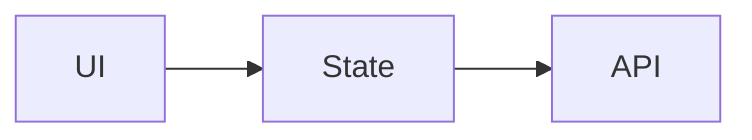

# Architecture map: <app>
Repo: <url> @ `<commit>` · Mapped: <YYYY-MM-DD> · Checked by a human: yes | no

<!-- Every claim cites a file path (and line where useful). Claims a human could not verify against the code are removed, not softened. -->

## One-paragraph summary
<!-- what the app does and how it is put together -->

## Components
| Component | Path | Responsibility |
|---|---|---|
|  |  |  |

## Data flow
<!-- one user action, traced from input to render, with file paths -->
1. 

## Tests
<!-- frameworks, where tests live, how to run them, what is and isn't covered -->
- 

## Build and CI
<!-- what runs, when (push / PR), what blocks a merge; cite the workflow files -->
- 

## Local run results
<!-- install, lint, typecheck, test, build: command, result, date -->
| Command | Result |
|---|---|
|  |  |

## Open questions
- 
